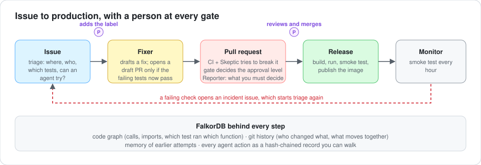
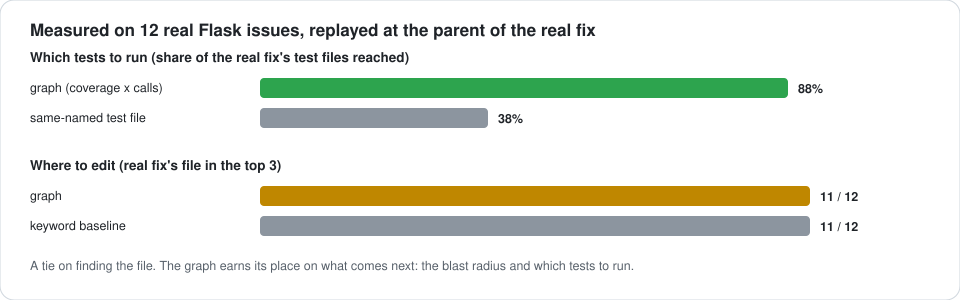
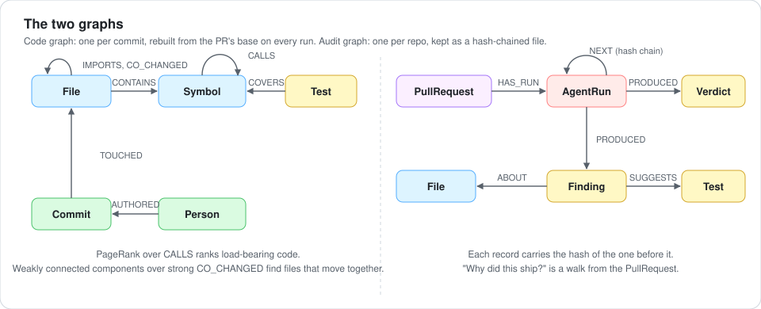

# Keel

Agents in the risky steps of shipping code, with a graph deciding how far to trust them and a person at every gate.



After AI writes code, the slow and risky steps are review, testing, security and release. Keel puts agents in those steps
and makes a second agent check the first, so a person can see why a change was allowed through. A code graph in FalkorDB
sits behind every decision, and every agent action is stored in a graph too, so "why did this ship?" is a query, not a log
search. Nothing in Keel merges, closes or assigns anything.

Track: Agents That Act on Connected Data (secondary: Agent Memory).

## See it run

All of this ran on this repo, on a small URL shortener in [`demo-app/`](demo-app/).

| | what happened |
|---|---|
| [PR #1](https://github.com/Siddhartha20242/Keel/pull/1) | A docstring change. The graph picked 7 of 12 tests, the Skeptic said `RISK: low`, the gate asked for one human approval. |
| [PR #2](https://github.com/Siddhartha20242/Keel/pull/2) | A "simplification" that inverts the dedupe check. 3 tests fail, the Skeptic said `RISK: high` and named `Store.shorten`, the gate blocked it. |
| [PR #5](https://github.com/Siddhartha20242/Keel/pull/5) and [#6](https://github.com/Siddhartha20242/Keel/pull/6) | The Fixer's two draft PRs for #2. #5 was wrong (it edited an unrelated line and still claimed success, a flaw in my check). #6 is the correct fix and says "Verified: the 3 tests that failed in CI now pass". |
| [PR #3](https://github.com/Siddhartha20242/Keel/pull/3), [issue #4](https://github.com/Siddhartha20242/Keel/issues/4) | New code with no tests, flagged as untested. A bug report that the graph could not place, so triage said "needs human". |

## How it works

- **Issue.** Triage names where the code graph points, who has changed it, which tests cover it, and whether an agent could try.
- **Fix.** A person adds a label, or the Fixer reacts when the unit tests fail. The agent opens a draft PR only if the tests that
  failed now pass.
- **Pull request.** CI runs tests, image and SBOM, CodeQL, secret scanning and `pip-audit`. A graph analysis maps the diff onto
  the code at the PR's base, runs the tests the graph selects, and scores the risk. The Skeptic tries to break the change: it walks the code
  graph with read-only tools, cites the walk behind each finding, and suggests the test that would catch each problem. The gate reads its verdict, trusts only the bot's own comment, and fails on
  `RISK: high` or on tests the PR broke. The Reporter lists what a person still has to decide.
- **Release.** After a person merges, the image is built, run, smoke tested and published, then smoke tested every hour. A failing
  check opens an incident issue.
- **Memory.** When a PR closes, what happened to it goes into a hash-chained ledger and later triage and analysis recall it. Point Keel
  at a FalkorDB with `KEEL_STORE_HOST` (for example the one in `docker-compose.yml`, which keeps its data on a volume) and that graph
  is the source of truth, with the file on the `keel-memory` branch rewritten from it as a backup. With none set, the file is the store.
  GitHub's runners cannot reach a database on your machine, so in CI the files are the store.

The agent never writes Cypher. It picks from a fixed set of tools, and any symbol it names is checked against the graph first, so
an invented name returns `unknown_symbol` and runs nothing.

## Results



Each of the 12 issues is a real pallets/flask issue, replayed at the parent of its real fix with only the history up to that point.

- **Which tests to run is where the graph wins.** "Which tests exercise this function or its callers" is a graph question.
- **Finding the file is a tie** with a plain keyword search. The value is what comes after: the blast radius and the tests.
- **Test selection can be large** for central code (up to about 300 of 370 tests), so the agent runs the 40 most focused first (79%).

Reproduce: `python -m keel.evaluate --rebuild`.

## Do we need a graph database?

I took FalkorDB out and redid the same decisions with plain Python dicts on the same extracted data (`python -m keel.ablation`).

| 12 real Flask cases | plain dicts | FalkorDB |
|---|---|---|
| tests selected, blast radius, risk score, lane | identical on 12 of 12 | identical |
| time for those decisions | 0.3 to 1.5 ms | 34 to 859 ms (median 54) |
| build the graph | 8 ms | 342 ms |

| synthetic, 100k nodes and 400k edges | plain dicts | FalkorDB |
|---|---|---|
| PageRank | 2,533 ms | **22 ms** |
| weakly connected components | 229 ms | **48 ms** |
| callers within 3 hops, per query | **0.02 ms** | 5.6 ms with its BFS algorithm |
| load | **285 ms** | 17.0 s |

So at our real scale (about 500 symbols) a dict gives the same answers, faster. FalkorDB pulls ahead on graph algorithms as the
graph grows, and it is what makes the ledger and memory one shared, persistent, queryable store that the agents' tools and a human
can both ask ("why did this ship?"). If you only wanted the numbers, a dict would do. One finding is against my own code: the
`*1..N` Cypher pattern took 446 ms per query at 30k nodes where FalkorDB's BFS took 3 ms, so the risk score's caller and importer counts
now use BFS (identical answers on all 12 cases). The blast-radius and test-selection queries still use the slow pattern because they need
the route and hop count of each caller; they would be the next to change before a large repo.

## The graph



The code graph is rebuilt from the PR's base commit on every run (about 5 seconds on Flask), so it cannot drift from the repo.
The audit graph lives as a hash-chained file: editing or removing a record is detected and the chain says where it breaks.
The queries are in [`queries/`](queries/) with a one-line description of each in [`queries/README.md`](queries/README.md).

```bash
python -m keel.ledger verify  --file data/sample_ledger.jsonl
python -m keel.ledger explain --file data/sample_ledger.jsonl --pr 2     # every action behind that PR, walked through FalkorDB
```

`data/sample_ledger.jsonl` comes from three PRs I simulated locally, not from GitHub. A hash chain shows tampering; it does not
stop someone with write access from rewriting the whole chain.

## Run it

```bash
./scripts/setup.sh                              # venv, Flask checkout, FalkorDB on :6379 (Browser UI on :3000)
. .venv/bin/activate
python -m keel.evaluate --rebuild               # builds the 12 graphs and prints the results above
python -m keel replay 4995a775 --mode mutant    # apply a real fix, break it on purpose, watch the gate catch it
python -m keel replay 9822a035 --mode llm       # a model does the work (keys go in .env, see .env.example)
python -m pytest tests                          # 47 tests; some need FalkorDB
```

### With Docker (no Python setup, free)

```bash
docker compose up -d falkordb                                    # FalkorDB on a volume; FalkorDB Browser at http://localhost:3000
docker compose run --rm keel python -m keel.evaluate --rebuild   # the whole evaluation inside a container (about 45 s)
docker compose run --rm keel python -m pytest tests -q
```

Set `KEEL_STORE_PASSWORD` in `.env` to require a password; `KEEL_DB_PORT` and `KEEL_UI_PORT` change the host ports if 6379 or 3000 is taken.
`scripts/store_check.py` runs ten end-to-end checks against whatever store `.env` points at.

For the GitHub pipeline, add an `OPENAI_API_KEY` repository secret (any OpenAI-compatible endpoint; set `OPENAI_BASE_URL` and
`KEEL_MODEL` as repository variables) and let Actions open pull requests.

## What is not proven

[`STATUS.md`](STATUS.md) separates PROVEN, WRITTEN and UNKNOWN in full. The short version:

- It is one language (Python) and one repo (Flask, plus a small demo app). 12 issues is a small sample.
- The Fixer has one wrong attempt and one right one, with one model. The Skeptic embellishes (it once invented a `KeyError`),
  which is why the gate leans on the graph's numbers and a person reads the findings.
- The gate only blocks a merge if branch protection requires its check, which this repo does not set.
- The risk weights and lane thresholds are hand-set; there is no ground truth to score them against.
- I have not run Keel on a large monorepo; the 100k-node numbers above are synthetic.
- The persistent store is tested against FalkorDB in Docker (with a password, on a non-default port, and across a restart), not against a hosted service.

## AI assistance

I used an AI coding assistant for most of the implementation: Claude Code (Claude Sonnet 5.5). It wrote the large majority of the code,
queries, tests, diagrams and documentation, and all 28 commits in this repo are co-authored by it. Groq's `gpt-oss` models are the
models inside the agents.

What was mine: the problem and the track, the idea of using a graph for the merge decision instead of for retrieval, choosing Flask and
its real issues as test material, the FalkorDB, Docker and API setup, running the live pipeline, and deciding what to claim. I asked for
weak results to be reported as they came out, and `STATUS.md` does that (the stemming and diff experiments that made things worse, the
Fixer's wrong first attempt, the ablation showing a plain dict gives the same answers at this scale). The assistant also found and fixed
several bugs while measuring, including one where the graph could see the fix it was supposed to predict.
